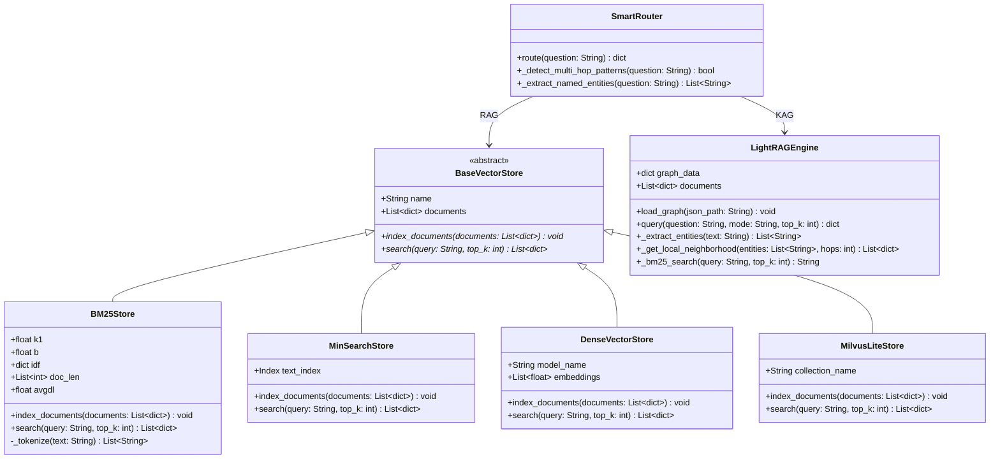
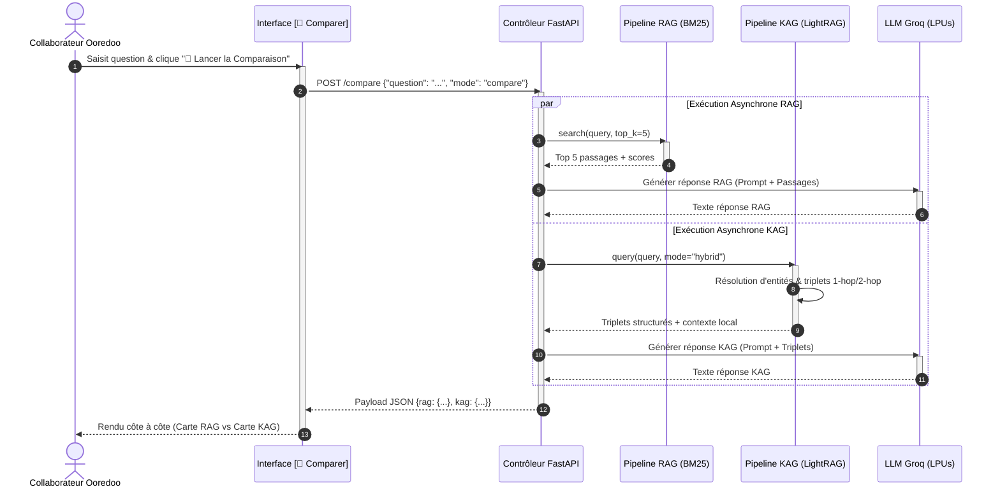
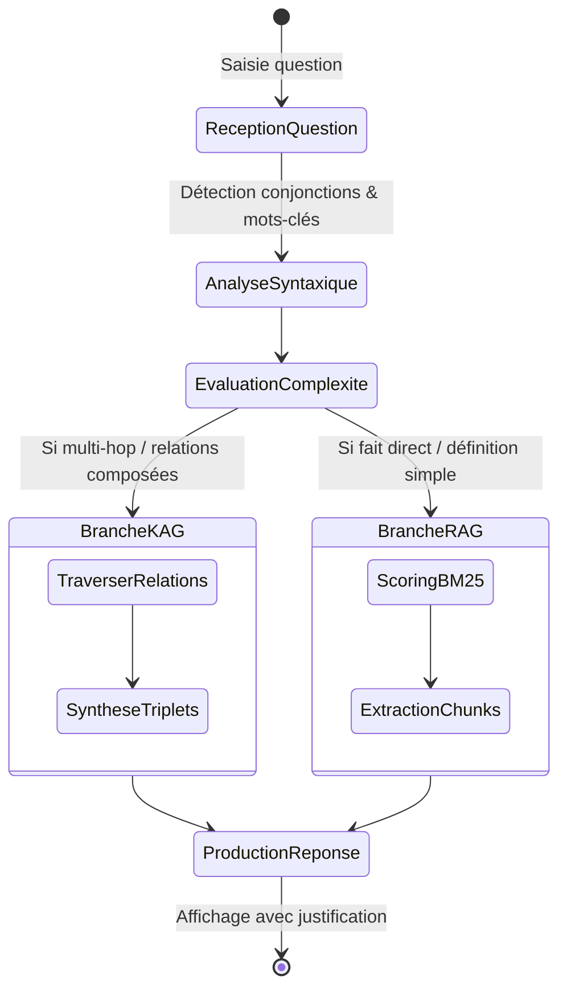
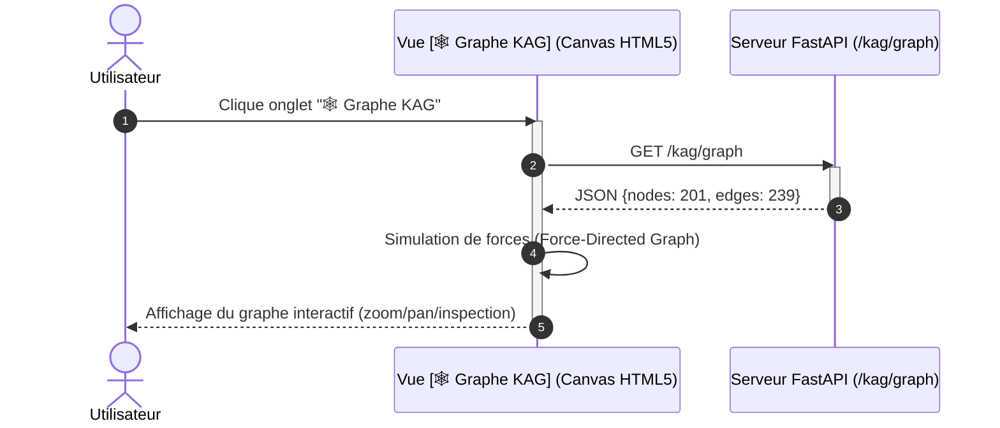
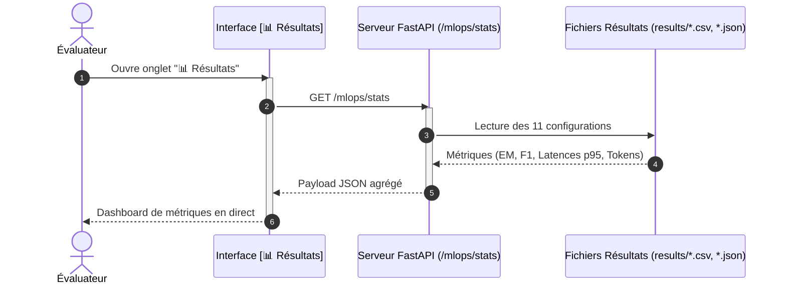

# DIAGRAMMES UML D'ARCHITECTURE ET DES INTERFACES

**Projet :** Plateforme de Benchmarking RAG vs KAG  
**Contexte :** Ooredoo Tunisie — Sujet 03  
**Auteur :** Ingénieur IA Stagiaire  

---

# 1. DIAGRAMME D'ARCHITECTURE GLOBALE DU SYSTÈME (COMPOSANTS)

```mermaid
graph TB
    subgraph UI_Layer ["1. COUCHE PRÉSENTATION (Frontend Web)"]
        UI_Compare["🖥️ Vue Comparer<br/>(Cartes RAG vs KAG)"]
        UI_Agent["🤖 Vue Agent<br/>(Explication de Routage)"]
        UI_Graph["🕸️ Visualiseur Canvas<br/>(201 nœuds / 239 arêtes)"]
        UI_Results["📊 Tableau de Bord MLOps<br/>(EM, F1, Latences)"]
    end

    subgraph API_Layer ["2. COUCHE CONTRÔLE & EXPOSITION (FastAPI)"]
        FastAPI_App["Serveur REST FastAPI<br/>(fast_server.py)"]
        EP_Compare["/compare & /query"]
        EP_Smart["/smart (Routage)"]
        EP_Graph["/kag/graph"]
        EP_Stats["/stats & /mlops/stats"]
    end

    subgraph Router_Layer ["3. COUCHE AGENTIQUE & ROUTAGE"]
        SmartRouter["Routeur Intelligent (SmartRouter)<br/>Analyse syntaxique & relationnelle"]
    end

    subgraph RAG_Subsystem ["4. SOUS-SYSTÈME RAG (Multi-VectorStore)"]
        BaseVS["«interface»<br/>BaseVectorStore"]
        BM25["BM25Store<br/>(Okapi BM25 pur)"]
        MinSearch["MinSearchStore<br/>(TF-IDF + Cosinus)"]
        Dense["DenseVectorStore<br/>(Hugging Face)"]
        Milvus["MilvusLiteStore<br/>(Index Vectoriel)"]
    end

    subgraph KAG_Subsystem ["5. SOUS-SYSTÈME KAG & LIGHTRAG"]
        LightRAG["Moteur LightRAG<br/>(5 Modes: naive, local, global, hybrid, mix)"]
        InMemKG["Base Graphe en Mémoire<br/>(kg_graph.json)"]
        GraphMLExport["Export GraphML<br/>(lightrag_graph.graphml)"]
    end

    subgraph Benchmark_Subsystem ["6. SOUS-SYSTÈME ÉVALUATION & MLOPS"]
        BenchRunner["Benchmark Runner<br/>(run_benchmark.py)"]
        CorpusDB["Corpus HotpotQA Commun<br/>(24 docs, 13 questions étalonnées)"]
        MetricEngine["Moteur Métriques<br/>(Exact Match, Token F1, Latence p95, Refus)"]
        ResultsCSV["results/*.csv & results/*.json"]
    end

    subgraph External_Inference ["7. COUCHE INFÉRENCE & MODÈLES EXTERNES"]
        GroqGateway["Passerelle Groq LPUs"]
        LLM_Gemma["Gemma 2 9B<br/>(Extraction triplets & entités)"]
        LLM_Llama["LLaMA 3.1 8B<br/>(Génération finale conditionnée)"]
        LocalCache["Cache Local des Réponses (Anti-Rate-Limit)"]
    end

    UI_Compare --> EP_Compare
    UI_Agent --> EP_Smart
    UI_Graph --> EP_Graph
    UI_Results --> EP_Stats
    EP_Compare & EP_Smart & EP_Graph & EP_Stats --> FastAPI_App

    FastAPI_App --> SmartRouter
    SmartRouter -->|Requête Factuelle / Définition| BaseVS
    SmartRouter -->|Requête Multi-Hop / Relationnelle| LightRAG

    BaseVS <|-- BM25
    BaseVS <|-- MinSearch
    BaseVS <|-- Dense
    BaseVS <|-- Milvus

    LightRAG --> InMemKG
    InMemKG --> GraphMLExport

    BenchRunner --> CorpusDB
    BenchRunner --> BaseVS
    BenchRunner --> LightRAG
    BenchRunner --> MetricEngine
    MetricEngine --> ResultsCSV
    ResultsCSV --> EP_Stats

    RAG_Subsystem --> GroqGateway
    KAG_Subsystem --> GroqGateway
    GroqGateway --> LocalCache
    GroqGateway --> LLM_Gemma
    GroqGateway --> LLM_Llama
```

---

# 2. DIAGRAMME DE CLASSES GLOBAL DU CŒUR MÉTIER



---

# 3. DIAGRAMMES UML PAR INTERFACE

## 3.1 Interface 1 : Vue `💬 Comparer` (Diagramme de Séquence)



## 3.2 Interface 2 : Vue `🤖 Agent` (Diagramme d'Activité)



## 3.3 Interface 3 : Vue `🕸️ Graphe KAG` (Diagramme de Séquence)



## 3.4 Interface 4 : Vue `📊 Résultats` (Diagramme de Séquence)


