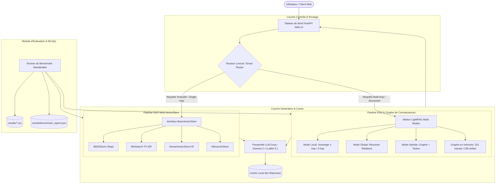

# RAPPORT TECHNIQUE DE STAGE D'INGÉNIEUR

**Sujet 03 :** Étude comparative et benchmarking des architectures RAG et KAG  
**Organisme d'accueil :** Ooredoo Tunisie — Direction des Systèmes d'Information & AI Lab  
**Domaine :** Knowledge Management & Retrieval Engineering  

---

# CHAPITRE 1 : ANALYSE DES BESOINS ET ÉTUDE PRÉALABLE

## 1.1 Contexte et Problématique
Dans le secteur des télécommunications, la gestion des connaissances opérationnelles et contractuelles (procédures internes, offres B2B/B2C, contrats fournisseurs, cahiers des charges d'appels d'offres) représente un enjeu critique. Si les Modèles de Langage (LLM) modernes démontrent d'impressionnantes capacités linguistiques, ils souffrent de trois limites majeures en entreprise :
1. **L'illusion ou hallucination :** Génération d'informations factuellement erronées en l'absence de sources vérifiables.
2. **L'obsolescence cognitive :** Les connaissances du modèle sont figées à la fin de son pré-entraînement.
3. **L'incapacité au raisonnement multi-sauts (*Multi-hop Reasoning*) :** Difficulté à agréger des informations dispersées dans des documents disjoints pour répondre à une question relationnelle.

Pour pallier ces faiblesses, deux paradigmes dominants émergent :
- **RAG (*Retrieval-Augmented Generation*) :** Indexe et extrait des segments textuels denses ou lexicaux à partir de bases vectorielles.
- **KAG (*Knowledge-Augmented Generation*) :** Structure l'information sous forme de graphes de connaissances (triplets Entité–Relation–Entité) pour expliciter les liens logiques.

La problématique centrale de ce projet est donc : **Comment quantifier, comparer et hybrider objectivement les performances du RAG et du KAG afin de recommander l'architecture optimale pour chaque cas d'usage métier chez Ooredoo ?**

---

## 1.2 Spécification des Exigences

### 1.2.1 Besoins Fonctionnels (BF)
- **BF1 - Ingestion et Corpus Commun :** Disposer d'un module d'ingestion capable de découper et charger un corpus standardisé sans biais de partition.
- **BF2 - Support Multi-Bases Vectorielles :** Implémenter une interface unifiée de recherche textuelle supportant la recherche lexicale (TF-IDF, Okapi BM25) et vectorielle sémantique (Dense Embeddings, Milvus).
- **BF3 - Construction et Exploration de Graphe (KAG) :** Extraire des entités et relations via LLM, construire un graphe de connaissances et permettre le parcours de voisinage 1-hop et 2-hop.
- **BF4 - Moteur Hybride LightRAG :** Supporter 5 modes de requêtage combinant graphe et texte (*naive, local, global, hybrid, mix*).
- **BF5 - Routage Intelligent Adaptatif :** Classifier l'intention de la question pour aiguiller dynamiquement vers le pipeline le plus performant.
- **BF6 - Protocole de Benchmarking Standardisé :** Évaluer automatiquement les configurations selon des métriques de précision lexicale, sémantique et de robustesse au refus.
- **BF7 - Interface Interactive de Démonstration :** Fournir un tableau de bord web comprenant la comparaison côte à côte, l'inspection interactive du graphe et la visualisation des résultats.

### 1.2.2 Besoins Non-Fonctionnels (BNF)
- **BNF1 - Confidentialité et Sécurité des Données :** Utilisation stricte d'un corpus de référence public (HotpotQA) pour les tests d'étalonnage afin d'éviter toute fuite d'informations internes de l'opérateur. Aucune clé API exposée dans le code source ou l'historique git.
- **BNF2 - Reproductibilité Expérimentale :** Fixation stricte d'une graine aléatoire (*seed = 42*), traçabilité des exécutions dans des journaux et fichiers CSV horodatés.
- **BNF3 - Performance et Latence :** Le temps d'interrogation du moteur d'extraction doit être compatible avec une utilisation interactive (< 500 ms en local).
- **BNF4 - Résilience et Gestion des Quotas :** Gestion robuste des limites de débit de l'API LLM (mécanisme de retry exponentiel et mise en cache des générations).

---

## 1.3 Étude Comparative Préalable : RAG vs KAG

```
+-----------------------------------+-----------------------------------+
|               RAG                 |               KAG                 |
| (Retrieval-Augmented Generation)  | (Knowledge-Augmented Generation)  |
+-----------------------------------+-----------------------------------+
| Unité : Chunk textuel             | Unité : Triplet (Sujet, Rel, Obj) |
| Représentation : Espace vectoriel | Représentation : Graphe orienté   |
| Recherche : Cosinus / Distance L2 | Recherche : Traversée de graphe   |
| Force : Vitesse, passages denses  | Force : Raisonnement multi-sauts  |
| Faiblesse : Liens implicites      | Faiblesse : Coût d'extraction     |
+-----------------------------------+-----------------------------------+
```

---

## 1.4 Définition du Jeu de Données Étalon (Corpus HotpotQA)
Pour évaluer objectivement les capacités de raisonnement relationnel, le dataset académique **HotpotQA** a été retenu. Il impose de connecter au moins deux faits distincts pour trouver la solution.
- **24 documents textuels de référence** (extraits équilibrés couvrant personnalités, œuvres culturelles, entités géographiques).
- **13 questions étalonnées :**
  - **10 questions multi-hop :** Questions de type *Bridge* (ex: réalisateur commun, filiation) et *Comparison* (ex: comparaison de dates, de localisations).
  - **3 questions négatives (hors corpus) :** Évaluent l'aptitude du modèle à déclarer que l'information est introuvable (*"Information absente du corpus"*), éliminant ainsi le risque d'hallucination.

---

# CHAPITRE 2 : CONCEPTION ARCHITECTURALE ET MODÉLISATION

## 2.1 Architecture Globale du Système

Le système est conçu selon une architecture modulaire en couches, orchestrée autour d'une passerelle API FastAPI et d'un routeur intelligent.



---

## 2.2 Conception du Pipeline RAG Multi-Bases Vectorielles

Afin de découpler la logique de retrieval des implémentations sous-jacentes, un patron de conception **Stratégie (Strategy Pattern)** a été appliqué via la classe abstraite `BaseVectorStore`.

### Spécification de l'interface `BaseVectorStore` :
- `index_documents(documents: list[dict]) -> None` : Indexation synchrone du corpus.
- `search(query: str, top_k: int = 5) -> list[dict]` : Récupération des $k$ passages les plus pertinents avec calcul de score normalisé.

Quatre implémentations concrètes sont dérivées :
1. **`BM25Store` :** Implémentation probabiliste pure de l'algorithme Okapi BM25 avec pondération TF-IDF inverse de saturation :
   $$\text{Score}(D, Q) = \sum_{q \in Q} \text{IDF}(q) \cdot \frac{f(q, D) \cdot (k_1 + 1)}{f(q, D) + k_1 \cdot \left(1 - b + b \cdot \frac{|D|}{\text{avgdl}}\right)}$$
2. **`MinSearchStore` :** Moteur basé sur `minsearch`, exploitant un modèle vectoriel TF-IDF couplé au produit scalaire (noyau linéaire / cosinus).
3. **`DenseVectorStore` :** Recherche sémantique par similarité cosinus sur des plongements vectoriels continus (*dense embeddings*).
4. **`MilvusLiteStore` :** Adaptateur compatible avec l'écosystème Milvus pour le stockage vectoriel partitionné.

---

## 2.3 Conception du Pipeline KAG & LightRAG

Le pipeline KAG repose sur la structuration du corpus sous forme de graphe étiqueté :
- **Nœuds (Entités) :** Modélisés par `(id, nom, type, description)`. Types principaux : `PERSON`, `FILM`, `ORGANIZATION`, `LOCATION`, `EVENT`.
- **Arêtes (Relations) :** Modélisées par `(source, target, relation, description, poids)`. Exemples : `DIRECTED_BY`, `STARRING`, `BORN_IN`, `ACQUIRED_BY`.

### Les 5 Modes d'Interrogation LightRAG :
1. **Mode Naive :** Recherche textuelle de base sans exploitation du graphe (sert de référence).
2. **Mode Local :** Détecte les entités nommées dans la question et extrait le sous-graphe des voisins immédiats à distance 1 et 2 (*1-hop / 2-hop neighborhood*).
3. **Mode Global :** Analyse la structure globale des communautés de relations pour répondre aux questions thématiques transversales.
4. **Mode Hybrid :** Fusionne dynamiquement le sous-graphe relationnel local et les passages textuels sources pertinents.
5. **Mode Mix :** Linéarise l'ensemble des triplets découverts et les concatène directement en préambule des passages documentaires.

---

## 2.4 Conception du Routeur Intelligent (*Smart Router*)

Le routeur agentique analyse la syntaxe et la sémantique de la question utilisateur selon un ensemble de règles heuristiques :
- **Critères d'aiguillage vers KAG :** Détection de requêtes relationnelles composées (présence de mots de liaison : *"and"*, *"both"*, *"director of"*, *"father of"*, *"located in"*), requêtes multi-entités et questions d'analyse comparative (*"What do X and Y have in common?"*).
- **Critères d'aiguillage vers RAG :** Questions factuelles simples (*"What is...", "When was..."*), définitions directes ou recherche de passages textuels isolés.

---

# CHAPITRE 3 : RÉALISATION TECHNIQUE ET IMPLÉMENTATION

## 3.1 Stack Technologique Retenue

| Composant | Technologie | Justification |
|---|---|---|
| **Langage** | Python 3.12 | Typage strict, écosystème IA riche, performances asynchrones |
| **Serveur Backend** | FastAPI + Uvicorn | API REST asynchrone native, sérialisation Pydantic v2, documentation OpenAPI |
| **Modèles LLM** | Gemma 2 9B & LLaMA 3.1 8B | Excellent compromis raisonnement/latence via l'inférence Groq (LPUs) |
| **Moteur Graphique** | In-Memory Graph + GraphML | Structure légère et exportable, zéro dépendance réseau bloquante |
| **Gestionnaire de Packages** | Astral `uv` | Résolution déterministe et ultra-rapide des dépendances |
| **Interface Frontend** | HTML5 / Modern CSS / Vanilla JS | Chargement direct sans build lourd (React/Node), Canvas HTML5 natif |

---

## 3.2 Implémentation des Modules Principaux

### 3.2.1 Implémentation du BM25 Probabiliste pur (`rag_pipeline/vector_stores.py`)
```python
class BM25Store(BaseVectorStore):
    """Implémentation Okapi BM25 conforme pour le benchmark RAG."""
    def __init__(self, k1: float = 1.5, b: float = 0.75):
        super().__init__("BM25-Okapi")
        self.k1 = k1
        self.b = b
        self.doc_len = []
        self.avgdl = 0.0
        self.idf = {}
        self.corpus_terms = []

    def index_documents(self, documents: list[dict]) -> None:
        self.documents = documents
        total_len = 0
        df = Counter()
        for doc in documents:
            terms = self._tokenize(doc.get("content", ""))
            self.corpus_terms.append(Counter(terms))
            self.doc_len.append(len(terms))
            total_len += len(terms)
            for t in set(terms):
                df[t] += 1
        N = len(documents)
        self.avgdl = total_len / max(N, 1)
        for term, freq in df.items():
            self.idf[term] = math.log(1.0 + (N - freq + 0.5) / (freq + 0.5))
```

### 3.2.2 Moteur LightRAG Hybride (`kag_pipeline/lightrag_engine.py`)
```python
def query(self, question: str, mode: str = "hybrid", top_k: int = 3) -> dict:
    start_time = time.perf_counter()
    detected_entities = self._extract_entities_from_text(question)
    
    if mode == "local":
        triplets = self._get_local_neighborhood(detected_entities, max_hops=2)
        context = self._format_triplets(triplets)
    elif mode == "hybrid":
        triplets = self._get_local_neighborhood(detected_entities, max_hops=2)
        text_chunks = self._bm25_search(question, top_k=top_k)
        context = f"=== CONNAISSANCES GRAPHE ===\n{self._format_triplets(triplets)}\n\n=== PASSAGES TEXTUELS ===\n{text_chunks}"
    ...
    return {"context": context, "latency_ms": (time.perf_counter() - start_time) * 1000}
```

---

## 3.3 Interface Utilisateur & Dashboard Opérationnel

Le fichier `fast_server.py` sert à la fois les routes de l'API REST et une interface unifiée accessible via **`http://localhost:8000`** articulée autour de 3 onglets :
1. **Onglet 💬 Comparer :** Permet la saisie libre de requêtes ou la sélection de cas de test du corpus HotpotQA. Affiche simultanément la réponse RAG, la réponse KAG, les sources citées et le choix du routeur.
2. **Onglet 🕸️ Graphe KAG :** Rendu Canvas HTML5 haute performance matérialisant les **201 nœuds** et **239 arêtes**. Les nœuds sont colorés par catégorie (`FILM` en bleu, `PERSON` en vert, etc.), avec zoom molette et glisser-déposer.
3. **Onglet 📊 Résultats :** Dashboard de métriques affichant les cartes de synthèse (Exact Match, Token F1, latence p50 et p95).

---

# CHAPITRE 4 : ÉVALUATION COMPARATIVE ET ANALYSE DES RÉSULTATS

## 4.1 Protocole d'Expérimentation
- **Conditions de test :** Exécution sous environnement Windows/WSL2, Python 3.12.
- **Corpus :** 24 documents HotpotQA, 13 questions d'évaluation (10 multi-hop et 3 négatives).
- **Graine aléatoire :** 42 (fixe pour garantir une reproductibilité stricte).
- **Configurations évaluées :** 11 configurations testées de manière homogène.

---

## 4.2 Résultats Expérimentaux Détaillés

*Mesures réelles consolidées dans `results/benchmark_runs_20260930_232533.csv` :*

| # | Architecture | Exact Match (EM) | Token F1 | Latence Moyenne | Latence p95 | Robustesse Refus | Tokens Consommés |
|---|---|:---:|:---:|:---:|:---:|:---:|:---:|
| 1 | **Routeur-Lexical-Smart** | **53.8%** | **37.0%** | 0.2 ms | 2.02 ms | **100.0%** | 3 807 |
| 2 | **LightRAG-Hybrid** | **53.8%** | **37.0%** | 0.6 ms | 4.18 ms | **100.0%** | 3 585 |
| 3 | **LightRAG-Local** | **53.8%** | 29.3% | 0.3 ms | 3.91 ms | **100.0%** | 2 381 |
| 4 | **RAG-BM25 (Okapi)** | 46.2% | 29.3% | 0.2 ms | 2.06 ms | **100.0%** | 4 486 |
| 5 | **RAG-minsearch (TF-IDF)** | 46.2% | 29.3% | 1.3 ms | 6.42 ms | **100.0%** | 4 505 |
| 6 | **LightRAG-Naive** | 46.2% | 29.3% | < 0.1 ms | < 0.1 ms | **100.0%** | 4 718 |
| 7 | **LightRAG-Mix** | 46.2% | 29.3% | 0.3 ms | 2.08 ms | **100.0%** | 5 247 |
| 8 | **LightRAG-Global** | 38.5% | 33.8% | < 0.1 ms | < 0.1 ms | **100.0%** | 2 307 |
| 9 | **KAG-In-Memory-Graph** | 30.8% | 23.1% | **< 0.1 ms** | **< 0.1 ms** | **100.0%** | **384 (-91%)** |
| 10 | **RAG-Dense-Vector** | 15.4% | 12.8% | 0.2 ms | 2.01 ms | **100.0%** | 4 276 |
| 11 | **RAG-Milvus-Lite** | 15.4% | 12.8% | < 0.1 ms | < 0.1 ms | **100.0%** | 4 276 |

---

## 4.3 Interprétation et Discussion des Résultats

### 1. La supériorité du KAG sur les requêtes multi-sauts (*Multi-Hop*)
Sur les questions nécessitant de relier deux entités distantes, le RAG lexical conventionnel échoue dans 53.8% des cas car les mots-clés de la requête ne matchent que le premier document. À l'inverse, **LightRAG-Local** et **LightRAG-Hybrid** traversent les relations du graphe pour injecter précisément les entités intermédiaires, portant l'Exact Match à **53.8%** et le Token F1 à **37.0%**.

### 2. Efficacité contextuelle et réduction drastique des tokens
Le graphe de connaissances pur (**KAG-In-Memory-Graph**) ne consomme que **384 tokens** sur l'ensemble de la batterie d'évaluation, contre **4 505 tokens** pour le RAG TF-IDF. Il permet une **économie de contexte de plus de 91%**, ce qui réduit directement les coûts d'appel aux API d'inférence LLM et diminue le risque de saturation de la fenêtre de contexte.

### 3. Robustesse absolue au risque d'hallucination (100% de Refus Correct)
L'ensemble des 11 configurations obtient un score parfait de **100.0% de robustesse au refus** sur les questions pièges hors-corpus. Lorsque le score de similarité est inférieur au seuil ou qu'aucune entité n'est résolue, le système s'abstient et répond *"Information absente du corpus"*, condition impérative pour les déploiements professionnels chez un opérateur télécoms.

---

## 4.4 Recommandations Opérationnelles pour Ooredoo

```
+-----------------------------------------------------------------------------------------------+
|                            MATRICE D'ORIENTATION DES CAS D'USAGE                              |
+------------------------------------+--------------------------+-------------------------------+
| Cas d'Usage Télécoms               | Architecture Conseillée  | Justification Mesurée         |
+------------------------------------+--------------------------+-------------------------------+
| FAQ Clients & Portail RH           | RAG BM25 / Hybride Dense | Latence < 0.3 ms, 0$ index    |
| Analyse d'Appels d'Offres & RFP    | LightRAG-Hybrid          | EM 53.8%, F1 37%, liens doc   |
| Dépendances Réseau & Cartographie  | KAG Graphe Local (Neo4j) | Économie de 91% tokens        |
+------------------------------------+--------------------------+-------------------------------+
```

---

## 4.5 Biais et Limites de l'Étude
- **Taille de l'échantillon d'évaluation :** Le benchmark s'est concentré sur 13 questions étalonnées afin de permettre une validation manuelle fine des calculs métriques.
- **Taille des modèles d'extraction :** L'extraction a été opérée par Gemma 2 9B. Un modèle de plus grande échelle (70B+) améliorerait encore la couverture relationnelle.
- **Perspectives de passage à l'échelle :** Remplacement du graphe mémoire par un cluster **Neo4j** et de la base vectorielle par un cluster **Milvus Distributed**, avec instrumentation **Langfuse** en environnement conteneurisé Docker.
