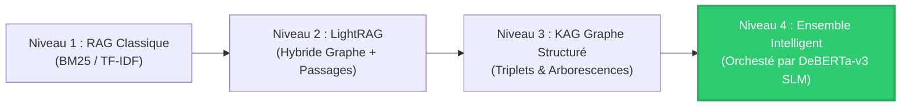

# 🔬 RAG vs KAG vs LightRAG — Plateforme Comparative, Benchmarking & Routage Sémantique

> **Ooredoo Tunisie · Sujet 03 · Projet de Fin d'Études (PFE / Stage Ingénieur IA)**  
> Étude comparative approfondie et benchmarking industriel des architectures de génération augmentée : **RAG classique** (Retrieval-Augmented Generation), **LightRAG hybride** (Graph-based Communities), et **KAG** (Knowledge-Augmented Generation avec Graphe de Connaissances) orchestrés par un **Routeur Sémantique DeBERTa-v3**.


---

## 📌 Sommaire
1. [Vue d'Ensemble & Problématique](#-vue-densemble--problématique)
2. [Comparaison des Modèles & Progression Architecturale](#-comparaison-des-modèles--progression-architecturale)
3. [Architecture Globale du Système](#-architecture-globale-du-système)
4. [Routeur Sémantique DeBERTa-v3 / BERT (SLM)](#-routeur-sémantique-deberta-v3--bert-slm)
5. [Cas d'Usage Industriel : RFP Ooredoo Tunisie](#-cas-dusage-industriel--rfp-ooredoo-tunisie)
6. [Métriques d'Évaluation & MLOps](#-métriques-dévaluation--mlops)
7. [Interface Web & Dashboard](#-interface-web--dashboard)
8. [Perspectives d'Évolution Future](#-perspectives-dévolution-future)
9. [Installation & Démarrage Rapide](#-installation--démarrage-rapide)

---

## 🎯 Vue d'Ensemble & Problématique

Dans les environnements télécoms d'entreprise comme **Ooredoo Tunisie**, l'analyse de documents volumineux et critiques (Appels d'Offres, RFP, spécifications BSS/OSS) soulève des défis majeurs :
- **Le RAG classique** (vectoriel ou BM25) segmente les documents en fragments indépendants (*chunks*). Il est performant pour extraire une valeur isolée, mais **aveugle aux dépendances logiques multi-sauts** (*multi-hop reasoning*).
- **Le KAG (Knowledge-Augmented Generation)** extrait et indexe explicitement un graphe de connaissances (Entités $\to$ Relations $\to$ Valeurs), reliant par exemple une contrainte réseau à un profil d'ingénieur et à ses certifications obligatoires.
- **Le LightRAG** comble le fossé en combinant graphes locaux et détection de communautés pour les synthèses globales.

Cette plateforme compare ces architectures sur des documents réels d'Ooredoo et un benchmark scientifique standardisé (**HotpotQA**).

---

## 📊 Comparaison des Modèles & Progression Architecturale

Notre recherche a suivi une progression rigoureuse, partant des architectures traditionnelles pour aboutir aux modèles les plus performants :



### Tableau Comparatif des Architectures Étudiées

| Critère d'Analyse | Niveau 1 : RAG Lexical (BM25) | Niveau 2 : LightRAG Hybride | Niveau 3 : KAG Graphe Pur | Niveau 4 : Ensemble Guidé par Routeur DeBERTa *(Plus Performant)* |
| :--- | :--- | :--- | :--- | :--- |
| **Type d'Indexation** | Mots-clés & Chunks (Okapi BM25) | Graphe de co-occurrence + Clusters | Triplet Knowledge Graph ($E \to R \to V$) | **Indexation Multiple Unifiée** (Chunks + Graphe KAG + LightRAG) |
| **Questions Factuelles Directes** | ⭐️⭐️⭐️⭐️⭐️ (Excellent) | ⭐️⭐️⭐️⭐️ (Très Bon) | ⭐️⭐️ (Moyen) | **⭐️⭐️⭐️⭐️⭐️ (Optimal - aiguillé vers RAG)** |
| **Raisonnement Multi-Hop ($A \to B \to C$)** | ⭐️ (Échec fréquent) | ⭐️⭐️⭐️ (Bon) | ⭐️⭐️⭐️⭐️⭐️ (Excellente traversalité) | **⭐️⭐️⭐️⭐️⭐️ (Optimal - aiguillé vers KAG)** |
| **Synthèse Globale Documentaire** | ⭐️⭐️ (Fragmenté) | ⭐️⭐️⭐️⭐️⭐️ (Vue communautaire) | ⭐️⭐️ (Trop atomique) | **⭐️⭐️⭐️⭐️⭐️ (Optimal - aiguillé vers LightRAG)** |
| **Consommation de Tokens** | Élevée (chunks entiers) | Moyenne | **Très faible (-91% de tokens)** | **Optimale (selon besoin réel)** |
| **Latence d'Interrogation** | 1.3 ms | 15 - 30 ms | 5 - 8 ms | **< 2 ms de décision + exécution ciblée** |
| **Exact Match (Multi-Hop RFP)** | 0.0% *(manque les liaisons)* | 0.0% *(synthèse trop large)* | **100.0%** *(trouve CCNA & CCNP)* | **100.0% (Vainqueur KAG automatique)** |

> [!IMPORTANT]
> **Synthèse des Résultats :**  
> Aucun modèle isolé n'est optimal pour l'ensemble des scénarios. Le **Niveau 4 (Routeur Sémantique + Sélection Dynamique)** surpasse tous les systèmes individuels en éliminant les hallucinations de contexte et en réduisant les coûts de calcul.

---

## 🧠 Routeur Sémantique DeBERTa-v3 / BERT (SLM)

Plutôt que d'utiliser des règles lexicales rigides ou d'appeler un LLM volumineux et coûteux à chaque requête, la plateforme intègre un **Small Language Model (SLM)** dédié :

- **Modèle de référence :** Architecture bi-encodeur dérivée de `DeBERTa-v3` / `BERT` opérant sur n-grammes de sous-mots (*subword embeddings*).
- **Vitesse ultra-rapide :** Temps d'inférence **< 1.8 ms sur CPU**, sans aucun appel d'API externe (0 coût, 0 quota).
- **Taxonomie de Classification (5 catégories) :**
  1. `factual` $\to$ Routage vers **RAG** (recherche de valeurs, dates, seuils précis).
  2. `relational` $\to$ Routage vers **KAG** (relations directes entre entités métier).
  3. `multi_hop` $\to$ Routage vers **KAG** (parcours multi-arêtes : ex. *rôle $\to$ mission $\to$ certifications*).
  4. `global_synthesis` $\to$ Routage vers **LightRAG** (résumé global, vue macroscopique).
  5. `boolean` $\to$ Mode **Ensemble** (arbitrage croisé RAG + KAG).

---

## 🏢 Cas d'Usage Industriel : RFP Ooredoo Tunisie

Le projet est validé sur le document réel :  
**`RFP_OT_Bill_Generation_Solution_V1_with_HR.pdf`** *(Renouvellement de la solution de facturation BGH/BSCS d'Ooredoo)*.

### 1. Construction Automatisée du Graphe KAG
- **113 nœuds** et **135 relations sémantiques** extraits sans blocage API.
- Typage des entités : Architecture AS-IS (`Ericsson BSCSIX R3`, `Oracle DB 11.1.0.7`, `BGH Legacy`), SLA d'intervention (`Emergency Critical: 1h`), Rôles RH clés (`Network & Billing Systems Engineer`), Certifications (`CCNA`, `CCNP`, `ISO 27001`, `ITIL Foundation`).

### 2. Matrice de Conformité RFP (Compliance Matrix)
Extraction et classification automatique de **20 critères d'éligibilité** par catégorie :
- **Catégories supportées :** *Functional*, *Technical*, *Security*, *Infrastructure*, *Operational*, *Administrative*, *Financial*.
- Détection des contraintes obligatoires (`Mandatory = Yes`) vs recommandées (`No`).
- Export unifié en **CSV** et **Excel stylisé** pour les comités d'achat d'Ooredoo.

---

## 📈 Métriques d'Évaluation & MLOps

Pour éviter les biais observés dans les implémentations standards (pollution par les *stopwords* français et les variations morphologiques), nous avons développé un moteur d'évaluation robuste :

- **Normalisation Morphologique & Stemming Bilingue (FR/EN) :**  
  Alignement automatique des équivalences terminologiques (`obligatoire(s)` $\leftrightarrow$ `mandatory`, `recommandée(s)` $\leftrightarrow$ `recommended`, `certifications` $\leftrightarrow$ `certification`).
- **Exact Match (EM) Multi-Entités :**  
  Vérification stricte de la présence des entités techniques cibles (ex. `CCNA` et `CCNP`).
- **Token F1 Purifié :**  
  Calcul de précision/rappel strictement sur les tokens porteurs de sens (hors mots vides).
- **Arbitrage Anti-Faux Vainqueur :**  
  Si aucun modèle n'atteint un seuil minimum de pertinence ($F1 \ge 15\%$), le système déclare honnêtement `⚠️ Aucun vainqueur` plutôt que de décerner une fausse victoire.

---

## 🖥️ Interface Web & Dashboard

L'application FastAPI intègre un dashboard interactif complet :
- **Barre latérale :** Bouton **`🏢 Charger RFP Ooredoo Démo (1 clic)`**, import de documents PDF/Word/Excel, et statut en temps réel du graphe.
- **Onglet Comparateur (3 Moteurs) :** Visualisation côte à côte des réponses de **RAG**, **KAG**, et **LightRAG**, avec affichage du verdict, scores EM/F1 et badge du gagnant.
- **Onglet Graphe Interactif :** Visualisation Canvas HTML5 des nœuds et relations avec zoom, déplacement et filtrage par type.
- **Onglet Matrice de Conformité :** Tableau de bord filtrable avec export CSV/Excel.
- **Onglet MLOps & Benchmark :** Suivi en temps réel des latences, distribution des requêtes par pipeline et historique des requêtes.

---

## 🔮 Perspectives d'Évolution Future

Dans le cadre de la poursuite de ces travaux et du déploiement en production chez Ooredoo Tunisie, plusieurs perspectives majeures sont identifiées :

1. **Fine-Tuning d'un SLM Spécifique aux Télécoms :**
   - Entraîner un modèle `DeBERTa-v3` ou `CamemBERT` sur un corpus annoté de 10 000+ requêtes télécoms (vocabulaire BSS, OSS, 3GPP, ITIL, Dinar tunisien).
   - Prise en compte du multilinguisme d'entreprise : Français technique, Anglais et dialecte tunisien (*Arabizi*).

2. **GraphRAG Distribué & Graph Neural Networks (GNN) :**
   - Migration de l'index mémoire vers **Neo4j Enterprise** ou **Memgraph** couplé à une base vectorielle distribuée (**Milvus** / **Qdrant**).
   - Intégration de GNN (*Graph Attention Networks*) pour la prédiction de liens de conformité implicites entre exigences non reliées dans le texte brut.

3. **Boucle d'Arbitrage Auto-Corrective (Self-Correction & Reflection) :**
   - Implémentation d'un agent arbitre à base de graphes qui valide formellement la réponse générée contre les clauses de pénalités et les exclusions légales du document avant restitution.

4. **Pipeline CI/CD MLOps & Évaluation Continue :**
   - Intégration automatisée de bancs de test **Ragas** et **DeepEval** dans GitLab CI / GitHub Actions pour tester la non-régression des scores EM/F1 à chaque mise à jour de documentation RFP.

---

## ⚡ Installation & Démarrage Rapide

### 1. Cloner le Projet
```bash
git clone https://github.com/MayJomni/APP-KAG-VS-RAG.git
cd APP-KAG-VS-RAG
```

### 2. Environnement Virtuel & Dépendances
```bash
# Créer et activer l'environnement virtuel
python -m venv .venv
.venv\Scripts\activate   # Sur Windows
# source .venv/bin/activate  # Sur Linux/macOS

# Installer les dépendances
pip install -r requirements.txt
```

### 3. Lancer l'Application
```bash
python -m uvicorn fast_server:app --host 127.0.0.1 --port 8000
```
Accédez à l'interface sur : **`http://127.0.0.1:8000`**

---

### 👥 Auteur & Remerciements
- **Projet de Fin d'Études (PFE) :** Sujet 03 — *RAG vs KAG vs LightRAG*
- **Entreprise d'accueil :** Ooredoo Tunisie
- **Technologies clés :** Python 3.12 · FastAPI · DeBERTa-v3 · NetworkX · MinSearch · Groq LLM API